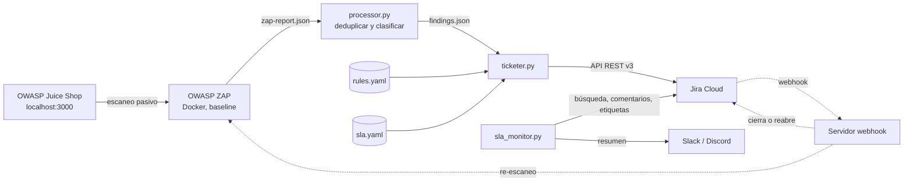

# vuln-pipeline

Pipeline de gestión del ciclo de vida de vulnerabilidades, a pequeña escala. Escanea una aplicación web con **OWASP ZAP**, procesa y clasifica los hallazgos, crea un ticket por hallazgo en **Jira Cloud** con responsable, etiquetas y fecha límite según reglas configurables, y avisa de los **SLA** por vencer o vencidos.

Es un proyecto de portafolio: replica, en versión reducida, el tipo de automatización que usan los equipos de seguridad para conectar scanners con un gestor de tickets. Está pensado para ejecutarse **únicamente contra OWASP Juice Shop levantado en la propia máquina** (ver [Seguridad](#seguridad)).

## Estado del proyecto

| Etapa | Estado |
|---|---|
| Escaneo con ZAP en Docker y reporte JSON | Hecho |
| Procesamiento: deduplicación, severidad y categoría OWASP | Hecho |
| Un ticket de Jira por hallazgo (idempotente) | Hecho |
| Reglas de asignación, etiquetas y escalamiento (YAML) | Hecho |
| SLA y fecha límite en el ticket | Hecho |
| Alertas de SLA (consola, comentario en el ticket, webhook de Slack/Discord) | Hecho |
| Webhook de Jira y validación de remediación (re-escaneo) | En desarrollo |
| Resumen y priorización con un LLM | Pendiente (opcional) |

## Arquitectura



Las líneas continuas están implementadas. Las punteadas (webhook y re-escaneo) son la siguiente etapa.

### Módulos

| Módulo | Responsabilidad |
|---|---|
| `src/scanner.py` | Ejecuta el escaneo baseline de ZAP en Docker. Solo acepta hosts de una lista permitida. |
| `src/processor.py` | Lee el reporte, normaliza URLs, deduplica con una huella estable, asigna severidad y categoría OWASP. |
| `src/rules.py` | Motor de reglas: decide responsable, etiquetas y severidad efectiva. Valida el YAML de forma estricta. |
| `src/sla.py` | Política de SLA: plazos por severidad y ventanas de aviso. |
| `src/jira_client.py` | Cliente mínimo de la API REST v3 de Jira Cloud. |
| `src/ticketer.py` | Crea los tickets (descripción, etiquetas, responsable y fecha límite). |
| `src/sla_monitor.py` | Revisa los tickets abiertos y avisa de los vencidos y por vencer. |
| `scripts/` | Utilidades de desarrollo (inspeccionar un reporte, reiniciar los tickets de prueba). |

## Estructura del repositorio

```text
vuln-pipeline/
├── config/
│   ├── owasp_map.yaml      # alertRef de ZAP -> categoría OWASP Top 10 (2021)
│   ├── rules.yaml          # reglas de asignación, etiquetas y escalamiento
│   └── sla.yaml            # plazos de remediación y ventanas de aviso
├── docs/img/               # capturas de pantalla del README
├── reports/                # reportes generados (ignorados por Git)
├── scripts/
│   ├── inspect_report.py
│   └── reset_tickets.py
├── src/
│   ├── scanner.py
│   ├── processor.py
│   ├── rules.py
│   ├── sla.py
│   ├── jira_client.py
│   ├── ticketer.py
│   └── sla_monitor.py
├── tests/
├── docker-compose.yml      # Juice Shop, publicado solo en 127.0.0.1
├── requirements.txt
├── requirements-dev.txt
└── .env.example
```

## Requisitos

- Linux o macOS (desarrollado y probado en CachyOS, basado en Arch).
- Docker y Docker Compose.
- Python 3.10 o superior.
- Una cuenta de Jira Cloud (el plan gratuito basta).
- Opcional: un webhook entrante de Slack o Discord para las alertas.

## Instalación

```bash
git clone https://github.com/Frobama/vuln-pipeline.git
cd vuln-pipeline

python -m venv .venv
source .venv/bin/activate          # en fish: source .venv/bin/activate.fish
pip install -r requirements-dev.txt

cp .env.example .env               # luego edítalo con tus valores
```

Si Docker no está activo en tu sistema (por ejemplo, en Arch):

```bash
sudo systemctl enable --now docker.service
sudo usermod -aG docker $USER      # cierra sesión y vuelve a entrar
```

## Configuración de Jira

1. Crea un sitio de Jira Cloud y un **proyecto de software** (Kanban o Scrum). Anota su clave, por ejemplo `SCRUM`.
2. Genera un API token en <https://id.atlassian.com/manage-profile/security/api-tokens> con **Create API token**. Dale una expiración corta (30 a 90 días). El token clásico funciona contra `https://tu-sitio.atlassian.net`.
3. Completa el archivo `.env` con un editor (no con `echo`, para que el token no quede en el historial del shell):

   ```bash
   JIRA_BASE_URL=https://tu-sitio.atlassian.net
   JIRA_EMAIL=tu-correo@ejemplo.com
   JIRA_API_TOKEN=...
   JIRA_PROJECT_KEY=SCRUM
   JIRA_ISSUE_TYPE=Task

   # accountId de cada responsable lógico definido en config/rules.yaml
   JIRA_ASSIGNEE_APPSEC=
   JIRA_ASSIGNEE_PLATAFORMA=
   JIRA_ASSIGNEE_FRONTEND=

   # Opcional: webhook entrante de Slack o Discord para las alertas de SLA (es un secreto)
   ALERT_WEBHOOK_URL=
   ```

4. Comprueba la conexión:

   ```bash
   python -m src.jira_client
   ```

   Muestra tu usuario, tu `accountId` (úsalo en `JIRA_ASSIGNEE_*`) y los **tipos de issue disponibles** en el proyecto. Los nombres dependen del idioma del sitio: en un Jira en español el tipo se llama `Tarea`, no `Task`. Ajusta `JIRA_ISSUE_TYPE` en consecuencia; el ticketer valida este valor antes de crear nada.
5. El campo **Fecha de vencimiento** (`duedate`) debe estar disponible al crear issues. Si Jira responde que `duedate` no se puede asignar, agrégalo al diseño del tipo de issue en la configuración del proyecto (debe ser el campo del sistema, no uno personalizado con el mismo nombre).

## Uso

### 1. Levantar Juice Shop

```bash
docker compose up -d
curl -I http://127.0.0.1:3000      # debe responder 200
```

Juice Shop queda publicado solo en `127.0.0.1` y dentro de la red Docker `vulnnet`, desde donde ZAP lo alcanza como `http://juiceshop:3000`.

### 2. Escanear

```bash
python -m src.scanner
```

Ejecuta `zap-baseline.py` de la imagen `ghcr.io/zaproxy/zaproxy:stable` y genera `reports/zap-report.json` y `reports/zap-report.html`. La primera vez descarga la imagen (más de 1 GB).

Opciones: `--target`, `--name`, `--spider-minutes` y `--ajax` (activa el AJAX spider; ver [Limitaciones](#limitaciones-conocidas)).

Para inspeccionar la estructura de un reporte:

```bash
python scripts/inspect_report.py
```

### 3. Procesar el reporte

```bash
python -m src.processor
```

Lee el reporte, deduplica, clasifica y guarda `reports/findings.json`. Imprime un resumen y avisa de las alertas que todavía no tienen categoría OWASP en `config/owasp_map.yaml`. Por defecto se descartan los hallazgos informativos (`--min-severity info` los incluye).

### 4. Crear los tickets en Jira

Conviene avanzar en este orden:

```bash
python -m src.ticketer --dry-run      # muestra qué se crearía, sin crear nada
python -m src.ticketer --limit 1      # crea un solo ticket para revisar su aspecto
python -m src.ticketer                # crea el resto
python -m src.ticketer                # segunda ejecución: no debe crear nada
```

La segunda ejecución termina con `creados=0`: el proceso es **idempotente**. Opciones: `--findings`, `--rules`, `--sla`, `--dry-run`, `--limit`.

Cada ticket incluye severidad (reportada y efectiva), categoría OWASP, URL afectada, parámetro, CWE, descripción, remediación recomendada, evidencia, referencias, fecha límite del SLA y las reglas que se le aplicaron.

### 5. Revisar el SLA

```bash
python -m src.sla_monitor                    # solo lectura: informa por consola
python -m src.sla_monitor --comment          # además, comenta y etiqueta cada alerta nueva
python -m src.sla_monitor --webhook          # además, envía un resumen a Slack/Discord
```

Sin banderas el monitor **no escribe nada** y se puede repetir las veces que se quiera. Con `--comment` o `--webhook` notifica una sola vez por ticket y estado: marca el ticket con `sla-por-vencer` o `sla-vencido`, y las siguientes ejecuciones lo muestran como `(ya notificado)`. Si un ticket pasa de "por vencer" a "vencido", se avisa de nuevo.

Para probar sin esperar días se puede simular la fecha:

```bash
python -m src.sla_monitor --today 2026-11-30
```

Cuidado: si se combina `--today` con `--comment` o `--webhook`, las etiquetas de estado quedan en Jira y suprimirán los avisos reales. Después de una demo, reinicia los tickets (ver más abajo).

### 6. Programar la revisión (opcional)

Con un temporizador de systemd de usuario. Crea `~/.config/systemd/user/vuln-sla.service`:

```ini
[Unit]
Description=Revisión de SLA de vuln-pipeline

[Service]
Type=oneshot
WorkingDirectory=%h/ruta/a/vuln-pipeline
ExecStart=%h/ruta/a/vuln-pipeline/.venv/bin/python -m src.sla_monitor --comment
```

y `~/.config/systemd/user/vuln-sla.timer`:

```ini
[Unit]
Description=Revisión diaria de SLA

[Timer]
OnCalendar=*-*-* 09:00:00
Persistent=true

[Install]
WantedBy=timers.target
```

```bash
systemctl --user daemon-reload
systemctl --user enable --now vuln-sla.timer
systemctl --user list-timers
```

Agrega `--webhook` al `ExecStart` si configuraste `ALERT_WEBHOOK_URL`.

### Reiniciar los tickets de prueba

```bash
python -m scripts.reset_tickets          # simula: cuenta los issues con la etiqueta vulnpipe
python -m scripts.reset_tickets --yes    # los borra (irreversible)
```

Solo afecta a los issues con la etiqueta `vulnpipe` del proyecto configurado en `JIRA_PROJECT_KEY`.

## Configuración

### `config/rules.yaml`: reglas de asignación

Cada regla tiene condiciones (`match`) y acciones (`actions`). Una regla coincide si se cumplen **todas** sus condiciones. Condiciones válidas: `severity`, `owasp` (prefijo, por ejemplo `A05`), `alert_ref`, `name_regex` y `url_regex`.

Cada acción tiene su propia semántica:

| Acción | Semántica |
|---|---|
| `labels` | Se **acumulan** de todas las reglas que coinciden. |
| `assignee` | Gana la **primera** regla (en orden) que lo define; si ninguna, se usa `defaults.assignee`. |
| `severity` | Solo puede **escalar** la severidad, nunca bajarla. |

Los responsables son claves lógicas (`appsec`, `plataforma`, `frontend`). El `accountId` real se lee de la variable `JIRA_ASSIGNEE_<CLAVE>`, de modo que el repositorio no contiene identificadores de personas.

ZAP solo emite severidad informativa, baja, media y alta. El nivel **crítico** existe únicamente a través de reglas: en la configuración de ejemplo, los hallazgos bajo `/ftp` (archivos de respaldo y binarios expuestos) se escalan a crítica por decisión de negocio.

El archivo se valida al cargarlo: una clave desconocida, una expresión regular inválida o una regla sin condiciones abortan la ejecución antes de tocar Jira.

### `config/sla.yaml`: plazos y avisos

| Severidad | Plazo (días corridos) | Aviso cuando faltan |
|---|---|---|
| Crítica | 3 | 1 día |
| Alta | 7 | 2 días |
| Media | 30 | 7 días |
| Baja | 90 | 14 días |
| Informativa | 180 | 30 días |

El plazo se calcula con la **severidad efectiva** (después de aplicar las reglas) y se guarda en el campo nativo `duedate` de Jira. La validación rechaza configuraciones incoherentes (por ejemplo, una crítica con más plazo que una alta) y ventanas de aviso que no sean menores que el plazo.

### `config/owasp_map.yaml`: categoría OWASP

Asocia el `alertRef` de cada alerta de ZAP con una categoría del OWASP Top 10 (2021). Cada entrada se tomó de las etiquetas que ZAP publica para esa alerta en su documentación. Es una clasificación **heurística** de ZAP, no un veredicto.

## Qué ve el equipo en Jira

| Etiqueta | Significado |
|---|---|
| `vulnpipe` | Ticket creado por el pipeline |
| `severity-<nivel>` | Severidad efectiva |
| `severity-escalated` | Una regla elevó la severidad que reportó ZAP |
| `owasp-aNN` | Categoría OWASP Top 10 |
| `fp-<huella>` | Identidad estable del hallazgo (base de la idempotencia) |
| etiquetas de `rules.yaml` | Por ejemplo `hardening-headers` o `equipo-plataforma` |
| `sla-por-vencer`, `sla-vencido` | Estado de las alertas de SLA |

## Decisiones de diseño

- **Huella estable.** Un hallazgo se identifica por `alertRef` + método + URL sin query string + parámetro, resumido en un hash de 12 caracteres. Se usa `alertRef` y no `pluginid` porque una misma regla de ZAP emite varios subtipos (por ejemplo, COEP y COOP comparten `pluginid`); un test cubre esa colisión. La huella es un **contrato**: cambiar cómo se calcula deja huérfanos los tickets ya creados.
- **Idempotencia con Jira como fuente de verdad.** La huella viaja en una etiqueta del ticket. Antes de crear, el ticketer hace una sola búsqueda y omite lo que ya existe. No hay estado local. Los tickets cerrados también cuentan como existentes.
- **Validar la configuración al inicio.** El tipo de issue, las reglas y el SLA se validan antes de crear nada. Fallar pronto evita estados a medias.
- **El procesador no decide riesgo.** Normaliza y clasifica. La severidad efectiva sale de reglas declarativas y se guardan ambas (la reportada y la efectiva) para poder auditar un escalamiento.
- **Estado de las alertas en etiquetas.** Es visible, filtrable con JQL y no depende de un archivo local. La entrega es *al menos una vez*: ante un fallo parcial se prefiere repetir un aviso a perderlo.
- **"Abierto" por categoría de estado.** Se usa `statusCategory.key` (`new`, `indeterminate`, `done`), que no depende del idioma, y no el nombre del estado.
- **Tiempo inyectado.** Las funciones de SLA reciben la fecha como parámetro, lo que permite probarlas con fechas fijas y simular días en una demo.
- **Un solo resumen al webhook de chat.** Respeta el límite de 2000 caracteres de Discord y evita enviar un mensaje por ticket.

## Seguridad

- **Alcance.** `scanner.py` solo acepta los hosts de una lista permitida (por defecto, `juiceshop`). Escanear cualquier otro destino exige modificar esa lista de forma consciente. Escanea únicamente sistemas que controlas.
- **Juice Shop aislado.** Es una aplicación vulnerable a propósito. Se publica en `127.0.0.1` y no en todas las interfaces, para que nadie más en tu red pueda alcanzarla.
- **Secretos.** Las credenciales viven en `.env`, ignorado por Git. `.env.example` solo contiene los nombres de las variables. Comprueba con `git check-ignore .env` que el archivo está ignorado. Si alguna vez subes un secreto por error, **revócalo primero** y después limpia el historial.
- **Tokens con expiración.** El token de Jira se crea con vencimiento corto.
- **Sin filtraciones en errores.** El cliente de Jira nunca imprime credenciales, y el envío al webhook de chat oculta la URL en sus errores (esa URL contiene el token del webhook).
- **Antes de publicar el repositorio,** revisa que las capturas no muestren correos, `accountId` ni URLs de webhooks.

## Tests

```bash
python -m pytest -q
```

Cubren la deduplicación y la huella, el cálculo de ADF y etiquetas, el motor de reglas (acumulación, desempate, escalamiento y rechazo de configuración inválida), la política de SLA, la clasificación de alertas y el envío al webhook (incluido que los errores no filtren la URL).

## Limitaciones conocidas

- **Escaneo pasivo.** `zap-baseline.py` analiza respuestas pero no ataca: detecta cabeceras ausentes, cookies mal configuradas o fugas de información, y **no** inyecciones ni XSS reales. Solo cubre lo que el spider alcanza sin autenticarse.
- **AJAX spider desactivado por defecto.** Juice Shop es una SPA y ese spider mejoraría la cobertura, pero en mi entorno el job del navegador headless hacía fallar el plan de ZAP. No determiné la causa raíz; queda como opción experimental (`--ajax`).
- **Rutas falsas.** El spider puede extraer "URLs" de páginas de error (por ejemplo, un `archivo.js:52:13` de una traza), que se convierten en hallazgos.
- **Categoría OWASP heurística.** Proviene de las etiquetas de ZAP. Algunas asignaciones son discutibles y el mapa usa el Top 10 de 2021.
- **Reglas solo al crear.** Si `rules.yaml` cambia, los tickets existentes conservan su responsable, etiquetas y fecha. Falta un reconciliador que no pise cambios hechos a mano.
- **El reloj del SLA parte al crear el ticket,** no al detectar el hallazgo, y usa días corridos. Para medir cumplimiento con rigor habría que partir de la fecha del escaneo y considerar feriados.
- **Responsables de demostración.** La lógica admite varios responsables, pero en la demo todos apuntan al mismo usuario; las etiquetas distinguen a los equipos.
- **Token clásico de Jira.** Es el más simple. Atlassian también ofrece tokens con alcance (scopes), que usan otra URL base.

## Hoja de ruta

- Servidor de webhook que reciba el cambio a "Listo", vuelva a escanear la URL afectada y cierre o reabra el ticket según el resultado.
- Reloj del SLA desde la fecha de detección.
- Reconciliación de tickets cuando cambian las reglas.
- Opcional: resumen en lenguaje claro y propuesta de prioridad con un LLM, como primer paso hacia un agente.


## Aviso

Este proyecto es solo con fines educativos y de portafolio. Escanea únicamente aplicaciones que controles y para las que tengas autorización.
